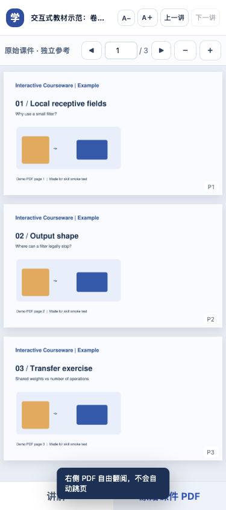

# Interactive Courseware Teacher · 互动课件教师

面向 **NLP、深度学习、LLM 与 Agent** 学习，将课程 PDF、PPTX 或讲义制作成离线互动教材：**简单页简述、难点精讲，原课件独立对照，按需加入计算实验与练习**。

这是一个可供 Codex 使用的 **Agent Skill**，附带本地 HTML 生成器。Skill 指导 AI 审阅课件、撰写讲义和复核数学；生成器把已经写好的 `lesson.json` 与 PDF 编译成网页。它不会自动把任意 PDF 转成高质量讲解。

[Skill 指令](SKILL.md) · [数据格式与构建](references/build-and-schema.md) · [教学写作](references/pedagogy.md) · [质量检查](references/qa.md)

## 效果预览

桌面端：左侧整篇讲义连续展开，右侧整份课件连续滚动。左右独立，点击“对照本页 PDF”才主动定位。


手机端：通过“讲解 / 原始课件 PDF”标签切换，并保留各自的滚动位置。



截图来自仓库内自制的三页演示 PDF，不包含个人课程材料。

## 可以做什么

- 按 PDF 实际页码建立覆盖关系，结合文字与图表审阅，区分课件原意、教师补充和待核对内容。
- 通过直觉、符号与维度、推导、数字例子和易错点，把多页课件讲成连贯的知识链。
- 生成双栏 HTML：独立课件预览、字号调节、课件缩放和跳页、可拖动栏宽、本地笔记与复习标记。
- 支持连续阅读或逐讲切换、代码块和对照表；复用已有阅读器，无须为这些内容重写网页。
- 缓存原 PDF 页面图像，重建时复用；构建日志给出实际耗时。
- 内置两个真实计算实验：单通道卷积窗口乘加、卷积输出尺寸。
- 支持单选、数字输入和多问数字题；首次答错给提示，再错给解析。
- 将教材 HTML 和原 PDF 打包为 ZIP。生成后的教材不需要服务器、Node.js 或联网即可打开。

主要面向 NLP、深度学习、LLM、Agent 等 AI 课程。其他课程也可使用教学流程。课件已清楚表达的内容简述即可，不逐句翻译或按页平均扩写；新的实验类型需要另行实现。

## 安装到 Codex

### 方法一：让 Codex 安装

在有 `$skill-installer` 的 Codex 中输入：

```text
使用 $skill-installer 从 https://github.com/StephenJun04/interactive-courseware-teacher
安装仓库根目录中的 skill（path 为 .），安装名称为 interactive-courseware-teacher。
```

### 方法二：手动安装

macOS / Linux 终端中执行：

```bash
mkdir -p "$HOME/.agents/skills"
git clone https://github.com/StephenJun04/interactive-courseware-teacher.git \
  "$HOME/.agents/skills/interactive-courseware-teacher"
```

如果目标目录已经存在，先检查现有版本，不要直接覆盖。也可以下载 GitHub 的 **Code → Download ZIP**，解压后把仓库根目录作为 `interactive-courseware-teacher` 文件夹放到客户端支持的 skills 目录。需要保留整个文件夹，不能只复制 `SKILL.md`。

Codex 的个人 skill 目录与发现机制见 [官方 Build skills 文档](https://learn.chatgpt.com/docs/build-skills)。不同客户端的安装路径和调用方式可能不同；检测不到新增 skill 时可重启 Codex。

## 在 Codex 中使用

安装后，提供你的 PDF 或课件路径，再发送：

```text
使用 $interactive-courseware-teacher，基于我提供的课程 PDF 制作中文离线互动教材。
审阅指定范围的文字、图表和公式，建立页码覆盖表；其余页面保留原 PDF 对照。
先完成第 10–20 页的精讲，右侧保留整份原 PDF。
先判断略读、讲清或精讲；简单内容简述即可。
难点按需给推导、可复算数字例子、计算实验和带提示的练习，不按页平均配题。
最后交付 HTML、lesson.json 和包含原 PDF 的离线 ZIP，并说明实际完成范围和测试结果。
```

也可以指定整份课件、其他语言或不同布局。页码默认指 **PDF 从 1 开始的物理页码**，不是幻灯片中印刷的编号。

如果素材是 PPTX，需要先保真导出 PDF，再核对页数、顺序、公式和图示；仓库没有内置 PPTX 转换器。

## 不接入 AI：运行自制示例

以下命令从克隆后的仓库根目录运行，适用于 macOS / Linux 的 shell。需要 Python 3、Node.js 和 npm；首次安装依赖需要联网，构建完成后的教材可以离线使用。

### 1. 准备隔离的构建环境

```bash
python3 -m venv .venv
.venv/bin/python -m pip install pymupdf
npm install --prefix work/node --no-audit --no-fund mathjax-full
```

Windows 可使用 `.venv\Scripts\python.exe` 替代 `.venv/bin/python`，并按所用终端设置 `NODE_PATH`。

### 2. 检查 PDF 与讲义数据

```bash
.venv/bin/python scripts/inspect_pdf.py examples/demo.pdf --out work/demo_pages.json
.venv/bin/python scripts/check_lesson.py examples/demo.json --pdf examples/demo.pdf
```

文本提取只用于辅助审阅，图表和公式仍需视觉检查。

### 3. 生成离线 HTML 和 ZIP

```bash
NODE_PATH="$PWD/work/node/node_modules" .venv/bin/python scripts/build_reader.py \
  --lesson examples/demo.json \
  --pdf examples/demo.pdf \
  --out output/demo_reader.html \
  --zip output/demo_textbook.zip
```

用浏览器打开 `output/demo_reader.html`；分享时发送 `output/demo_textbook.zip`，接收者先解压再打开 HTML。示例应包含 **3 页 PDF、3 讲、3 道题、2 个实验**，以及静态 SVG 公式。

若构建日志显示 `Math SVG: False`，公式已降级为 LaTeX 文本。检查 Node 是否可执行、`mathjax-full` 是否安装、`NODE_PATH` 是否指向正确目录；不能把这类结果当作公式排版完成。

### 4. 可选：浏览器冒烟测试

```bash
.venv/bin/python -m pip install playwright
.venv/bin/python -m playwright install chromium
.venv/bin/python scripts/smoke_test.py \
  --html output/demo_reader.html \
  --screenshots work/screenshots
```

也可以通过 `--browser-executable /path/to/browser` 指定已有 Chrome / Chromium，省去下载测试浏览器。脚本会自动尝试本机常见 Chrome 路径；未找到时使用 Playwright Chromium。

冒烟测试检查讲次切换不移动 PDF、公式 SVG、已包含的实验和题型、笔记保存、375px / 768px 标签切换，以及无网络请求或 JavaScript 错误。它不证明任意讲义的教学质量或数学答案正确。

## 制作自己的教材

1. 审阅原课件，记录物理页码、图表、符号、前置知识和每页解决的问题。
2. 参照 [lesson.sample.json](templates/lesson.sample.json) 撰写自己的 `lesson.json`；`scope` 明确写出讲解起止页。
3. 独立核对推导、练习答案和实验假设，再运行静态校验器。
4. 将构建命令中的 `--lesson` 和 `--pdf` 换成自己的文件，输出写到任务目录。
5. 实际打开网页，检查首讲、中间、末讲、课件独立滚动、实验、判分和窄屏效果。

更完整的字段说明在 [构建与数据格式](references/build-and-schema.md)。教学、实验选择、练习与版式分别见 `references/`。

## 现有功能边界

| 项目 | 当前实现 |
| --- | --- |
| 连续讲解 | 默认整篇展开，导航定位左栏；`reading_mode: "paged"` 可逐讲切换 |
| 右侧 PDF | 原 PDF 的栅格页面预览；搜索、复制文字和矢量缩放使用另附的原 PDF |
| 卷积实验 | 单通道、stride=1、padding=0 的 cross-correlation；输入固定、核可编辑 |
| 输出尺寸实验 | 正方形、对称 padding、dilation=1；按合法起点计算输出 |
| 多问练习 | 全部小问统一判分，尚无逐小问反馈 |
| `remedial` 加练 | 首次答错显示追问文本；无独立判分；连续模式保留，逐讲模式切讲或刷新后不恢复 |
| 自动生成内容 | 需要 AI 或作者撰写 `lesson.json`，脚本本身不会理解课件 |
| 判分答案 | 内嵌在本地 HTML 中，供学习自测使用 |

笔记、错题次数和复习标记保存在当前浏览器的本地存储中，不会上传到服务器；清除浏览器数据或换浏览器可能使记录不可用。

## 仓库结构

```text
interactive-courseware-teacher/
├── README.md                 使用者说明
├── SKILL.md                  AI 工作流入口
├── agents/openai.yaml        Codex 展示元数据
├── scripts/                  提取、校验、构建、公式渲染和浏览器测试
├── templates/                讲义 JSON 示例与 HTML 模板
├── references/               教学、交互、练习、设计、数据格式与 QA
├── examples/                 自制演示 PDF 与讲义 JSON
└── docs/images/              README 效果图
```

运行示例只需公开测试文件。自己的课件、笔记、生成结果和依赖环境应保留在任务目录，不必提交到此仓库。

## 讲解深度

略读页：简述结论或变化并保留页码对照；讲清页：补新概念与隐含推理；精讲页：围绕关键机制、维度、计算或状态补必要推导、例子与练习。判断依据是课件自足程度和知识缺口，不是页面长短或字数。相邻页面重复同一机制时只解释新增步骤。

[AI 课程重点](references/ai-learning.md) 提供领域判断角度，不代表相关交互实验已经内置。

## 减少生成等待

先复用当前任务已审阅的素材、运行环境和页面框架。只精讲指定范围；完整 PDF 仍全部保留。新增实验才需要额外代码与计算验证。

构建默认在输出旁保存 `.courseware-cache`；可以设置 `--cache-dir work/pdf-cache`，`--no-cache` 跳过缓存，`--metrics-json work/build-metrics.json` 保存测量。PDF 内容、渲染参数或 PyMuPDF 版本改变时缓存失效。计时只包含构建，不包含 AI 阅读、撰稿或检查，不能承诺任意课件的总生成时长。

验证缓存和表格字段：`python scripts/regression_test.py`。浏览器冒烟测试同时支持连续和逐讲模式。
